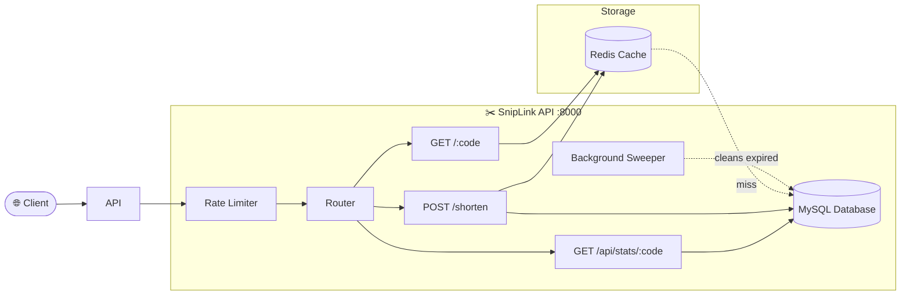

# ✂️ SnipLink — URL Shortener with Analytics

<p align="center">
  
  
  
  
  
</p>

> *"Every long journey begins with a single snip."*

**SnipLink** is a fast, analytics-enabled URL shortener built with **FastAPI**, **MySQL**, and **Redis**. It generates compact short codes via base62 encoding, caches redirects in Redis for sub-millisecond lookups, tracks per-click analytics (referrer, user-agent, IP), and automatically cleans up expired links via a background sweeper.

---

## ⚡ Architecture



---

## ✨ Features

- 🔗 **Base62 Short Codes**: Converts auto-increment IDs to compact alphanumeric codes (`12345` → `3d7`).
- 🏷️ **Custom Aliases**: Optionally provide a branded short code (e.g., `/my-brand`).
- ⏱️ **Link Expiration (TTL)**: Set `minutes_to_live` for auto-expiring links.
- ⚡ **Redis Caching**: Redirects are cached in Redis for sub-millisecond lookups. Cache is pre-populated on creation.
- 📊 **Click Analytics**: Every redirect logs the referrer, user-agent, and client IP. Query analytics via the stats API.
- 🚦 **Per-IP Rate Limiting**: Redis-backed rate limiter prevents abuse (10 req/min per IP).
- 🧹 **Background Sweeper**: Asyncio task periodically cleans up expired links from both MySQL and Redis.
- 🛡️ **Graceful Redis Fallback**: If Redis goes down, the app continues working (just without caching).
- 📐 **Clean Architecture**: Routes, services, models, and schemas are cleanly separated.

---

## 📁 Project Structure

```text
urlShortener/
├── main.py                  # FastAPI app entry point & lifespan
├── config.py                # Settings from .env (pydantic-settings)
├── database.py              # SQLAlchemy engine & session factory
├── models.py                # URL + ClickEvent database models
├── schemas.py               # Pydantic request/response schemas
├── routes/
│   ├── shortener.py         # POST /shorten, GET /{code}
│   └── analytics.py         # GET /api/stats/{code}
├── services/
│   ├── encoder.py           # Base62 encode/decode
│   ├── cache.py             # Redis wrapper with graceful fallback
│   └── sweeper.py           # Background expired-link cleaner
├── .env.example             # Environment variable template
├── .gitignore
├── requirements.txt
└── README.md
```

---

## 🚀 Getting Started

### 1. Prerequisites

- **Python 3.9+**
- **MySQL** (local or Docker)
- **Redis** (local or Docker)

**Quick Docker setup for MySQL + Redis:**

```bash
# Start MySQL
docker run -d --name mysql -e MYSQL_ROOT_PASSWORD=12345678 -e MYSQL_DATABASE=url_db -p 3306:3306 mysql:8

# Start Redis
docker run -d --name redis -p 6379:6379 redis:7
```

### 2. Install Dependencies

```bash
pip install -r requirements.txt
```

### 3. Configure Environment

```bash
cp .env.example .env
# Edit .env with your MySQL password
```

### 4. Run the Server

```bash
uvicorn main:app --port 8000 --reload
```

---

## 🧪 API Reference

### Create a Short URL

```bash
curl -X POST http://127.0.0.1:8000/shorten \
  -H "Content-Type: application/json" \
  -d '{"url": "https://en.wikipedia.org/wiki/URL_shortening"}'
```

**Response:**
```json
{
  "short_code": "3d7",
  "short_url": "http://127.0.0.1:8000/3d7",
  "original_url": "https://en.wikipedia.org/wiki/URL_shortening",
  "created_at": "2025-08-12T21:30:00",
  "expires_at": null
}
```

### Create with Custom Alias + TTL

```bash
curl -X POST http://127.0.0.1:8000/shorten \
  -H "Content-Type: application/json" \
  -d '{"url": "https://github.com", "custom_alias": "gh", "minutes_to_live": 60}'
```

**Response:**
```json
{
  "short_code": "gh",
  "short_url": "http://127.0.0.1:8000/gh",
  "original_url": "https://github.com/",
  "created_at": "2025-08-12T21:30:00",
  "expires_at": "2025-08-12T22:30:00"
}
```

### Redirect (Use the Short URL)

```bash
curl -L http://127.0.0.1:8000/3d7
# → Redirects to the original URL (HTTP 307)
```

### View Click Analytics

```bash
curl http://127.0.0.1:8000/api/stats/3d7
```

**Response:**
```json
{
  "short_code": "3d7",
  "original_url": "https://en.wikipedia.org/wiki/URL_shortening",
  "created_at": "2025-08-12T21:30:00",
  "expires_at": null,
  "total_clicks": 42,
  "recent_clicks": [
    {
      "clicked_at": "2025-08-12T21:45:00",
      "referrer": "https://twitter.com",
      "user_agent": "Mozilla/5.0...",
      "ip_address": "192.168.1.10"
    }
  ],
  "top_referrers": [
    {"referrer": "https://twitter.com", "count": 25},
    {"referrer": "https://reddit.com", "count": 12}
  ],
  "top_user_agents": [
    {"user_agent": "Mozilla/5.0...", "count": 30}
  ]
}
```

---

## 🏗️ Tech Stack

| Component | Technology | Why |
|---|---|---|
| **API Framework** | FastAPI | Async-native, auto-generated OpenAPI docs, dependency injection |
| **Database** | MySQL + SQLAlchemy | Relational storage for URLs and click events with ORM |
| **Cache** | Redis | Sub-millisecond redirect lookups, rate limiting counters |
| **Short Code Generation** | Base62 Encoding | Compact, URL-safe codes from auto-increment IDs |
| **Config** | pydantic-settings | Type-safe env variable loading with `.env` support |

---

## 🔮 Roadmap

- [ ] 📊 **Analytics Dashboard**: Web UI to visualize click trends, referrer breakdown, and geographic data.
- [ ] 🔐 **API Key Authentication**: Protect URL creation behind API keys.
- [ ] 🌍 **GeoIP Lookups**: Map client IPs to countries/cities for geographic analytics.
- [ ] 🐳 **Docker Compose**: One-command deployment of the full stack (API + MySQL + Redis).

---

## 📄 License

Distributed under the MIT License.
